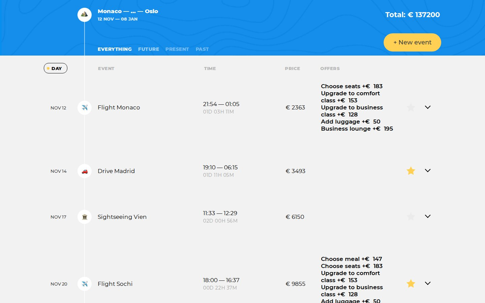

# Big Trip

A trip planner: a list of travel events with dates, prices and extra options, which you can
filter, sort, edit and save to a server. TypeScript in the model-view-presenter pattern, built
with webpack.

This is a training project, the second of three I built at HTML Academy in 2024. I wrote it from
April to June 2024 on the course
[JavaScript. Client application architecture](https://htmlacademy.ru/intensive/ecmascript),
and mentor [Arthur Litovko](https://htmlacademy.ru/profile/id6927) reviewed the pull requests.
The markup, styles and the small framework in `src/framework/` came with the task. The reviewed
original lives in [htmlacademy-ecmascript/2483435-big-trip-23](https://github.com/htmlacademy-ecmascript/2483435-big-trip-23).

[Live demo](https://htmlacademy-ecmascript.github.io/2483435-big-trip-23/19/) · [How it works](#how-it-works) · [Run locally](#run-locally)

The demo is the academy build of the last pull request and writes to the same academy server,
so changes made there are visible to anyone who opens it.

## What you can do

See the whole trip as a list of events: a flight, a taxi, a hotel check-in, nine types in all.
The header shows the route, the dates and the total cost including selected options. Filter
events by everything, future, present or past, and sort them by day, duration or price. Open an
event to change its type, destination, dates, price and options, mark it as a favourite, delete
it, or add a new one with the button at the top.

## How it works

### Models, views, presenters

Five models in `src/model/` hold the points, destinations, offers, the current filter and the
current sort. They extend the academy `Observable`, so a presenter subscribes once and redraws
when a model changes. Views only turn state into markup and report clicks. `list-presenter.ts`
ties it together and chooses how much to redraw: a `PATCH` update replaces one event, a `MINOR`
update rebuilds the list.

### Talking to the server

`src/service/point-api-service.ts` wraps the academy `ApiService`. The server uses snake_case
field names and the app uses camelCase, so `src/utils/case-changer.ts` converts whole objects
in both directions, with types in `types-utils.ts` that rename the keys at the type level too.
While a request is in flight, the academy `UiBlocker` covers the page if the request takes
longer than 350 ms and keeps it covered for at least 1000 ms, so the overlay doesn't flicker.
If the server refuses, the event row or the form shakes and stays editable.

### The edit form

`point-form-view.ts` keeps the edited event in its own state, apart from the model. Closing the
form with Escape or the arrow resets it to the stored point. Dates use flatpickr. Destination names and event types go through `he.escape` before
they land in the markup. Before sending, the form checks that both dates are set and the price is above 0 and below
100 000.

## Run locally

```bash
git clone https://github.com/murpiano/_big-trip.git
cd _big-trip
npm install

npm start         # webpack dev server, opens the browser
npm run lint      # ESLint with the academy config
npm run format    # Prettier over src/
npm run build     # production build into build/
```

`package.json` asks for Node 20. The project also builds on Node 24.

There are no tests, and `npm test` only prints an error. In the academy repository
`.github/workflows/check.yml` ran the linter on every pull request, and `build.yml` with
`publish.yml` put each build on GitHub Pages. Data lives on
`https://23.objects.htmlacademy.pro/big-trip`.

## Where things live

```text
src/
├── main.ts          creates the service, the models and the main presenter
├── framework/       academy base classes: views, Observable, ApiService, UiBlocker
├── model/           points, destinations, offers, filter, sort
├── presenter/       header, filters, sorting, list, one event, new event
├── view/            header and list views
├── templates/       markup builders for the form and the header
├── service/         server API and its settings
├── types/           shared types
└── utils/           dates, filters, sorting, case conversion
```

Presenters are the only place where models and views meet. Templates are plain functions that
return strings, which keeps the view classes short.

## Rough edges

- The authorization string is hard-coded in `src/service/create-service.ts`. Everyone who runs
  this repository reads and changes the same trip on the academy server.
- `SortingModel.getSortedPoints` sorts with `Array.prototype.sort`, which works in place. With
  the "everything" filter, and in the header route, that array is the model's own list, so
  sorting quietly reorders the stored points.
- Sorting by event and by offers keeps the current order: `getSortedPoints` returns the list
  unchanged for them.
- When the price or dates don't pass the check, Save does nothing and shows no message.

---

<sub>[Bogdan Trotsenko](https://github.com/murpiano) · [murpiano](https://github.com/murpiano) · [Telegram](https://t.me/murpiano)</sub>
